# Zig Abstract Syntax Tree

  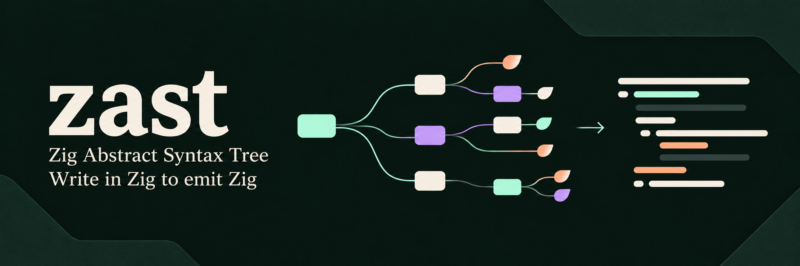

  
  
  
  

Build Zig source with composable descriptions backed by `std.zig.Ast`.

  <a href="docs/examples.md#complete-runner">Quick start</a> ·
  <a href="#reading-the-examples">Examples</a> ·
  <a href="#10-comments-and-documentation">Comments</a> ·
  <a href="src/root.zig">API</a> ·
  <a href="examples/flatbuf_json/README.md">FlatBuffers JSON</a> ·
  <a href="#license">License</a>

  
  
  
  

## Reading the examples

Click an illustration or its **Copy code** link to open the matching example
in [Copyable examples](docs/examples.md). The Zig snippets use the shared
[complete runner](docs/examples.md#complete-runner). The JSON sections use
their linked generators and inputs.

Descriptions provide values and types; `emit` adds a named declaration to the
file. The runner calls `finish` and `renderAlloc` once after generation.

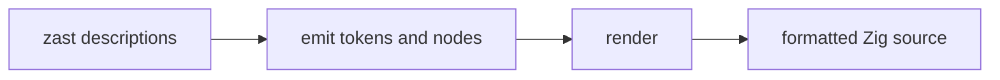

## 1. A constant

[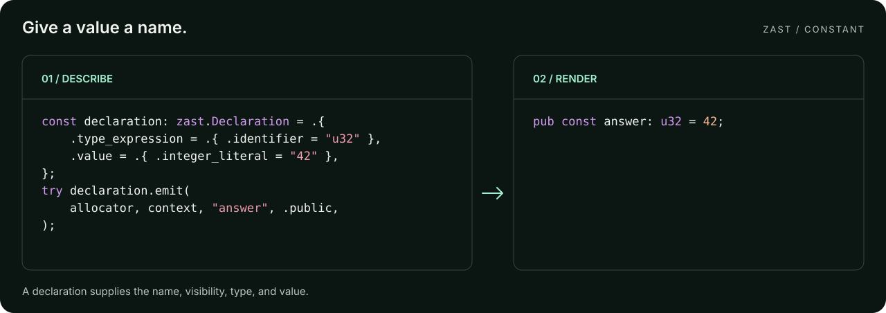](docs/examples.md#1-a-constant)

[Copy code](docs/examples.md#1-a-constant) ·
[Runnable example](examples/declarations.zig) · [Related tests](tests/test_declaration.zig)

The name and visibility belong to the declaration. Its type and value are
expressions. Set `.kind = .variable` to emit `var` instead of `const`.

## 2. Compose types

[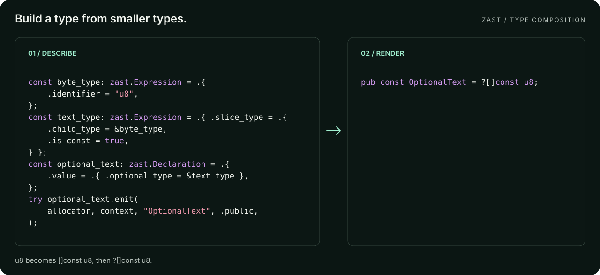](docs/examples.md#2-compose-types)

[Copy code](docs/examples.md#2-compose-types) ·
[Runnable example](examples/compound_types.zig) · [Related tests](tests/test_declaration.zig)

The child expressions remain alive until emission finishes. Arrays, pointers,
sentinels, qualifiers, and error unions compose in the same way; see
[compound_types.zig](examples/compound_types.zig).

## 3. An enum

[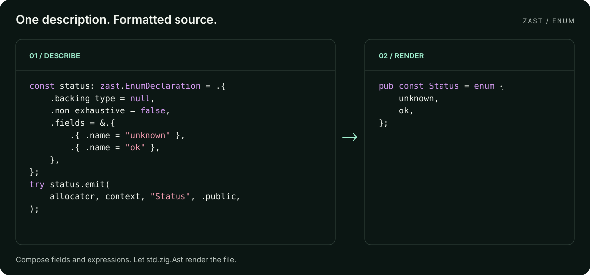](docs/examples.md#3-an-enum)

[Copy code](docs/examples.md#3-an-enum) ·
[Runnable example](examples/enum.zig) · [Related tests](tests/test_enum_declaration.zig)

Copyable code includes the inferred enum shown here and a variant with an
explicit backing type, numeric values, and a catch-all field.

`non_exhaustive` adds `_`. For an inferred `enum { ... }`, use a null backing
type, set `non_exhaustive` to false, and omit explicit field values.

## 4. A tagged union

[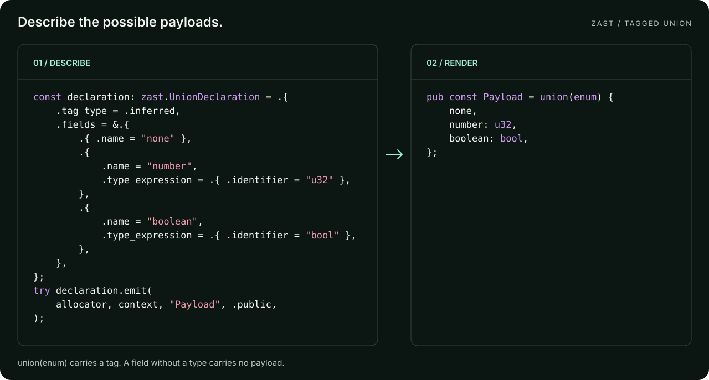](docs/examples.md#4-a-tagged-union)

[Copy code](docs/examples.md#4-a-tagged-union) ·
[Runnable example](examples/union.zig) · [Related tests](tests/test_union_declaration.zig)

Enum and union descriptions share `Field`. For this tagged union, a field
without a type has a `void` payload.

## 5. A function

[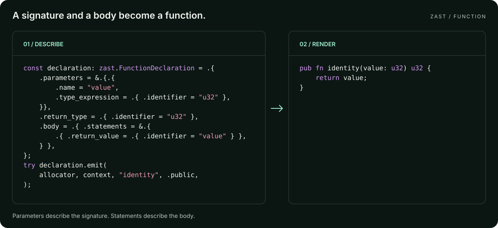](docs/examples.md#5-a-function)

[Copy code](docs/examples.md#5-a-function) ·
[Runnable example](examples/function.zig) · [Related tests](tests/test_function_declaration.zig)

Parameters describe the signature. `Block.Statement` describes the function
body: returns, declarations, assignments, calls, and nested blocks.

## 6. Reuse a function inside a struct

[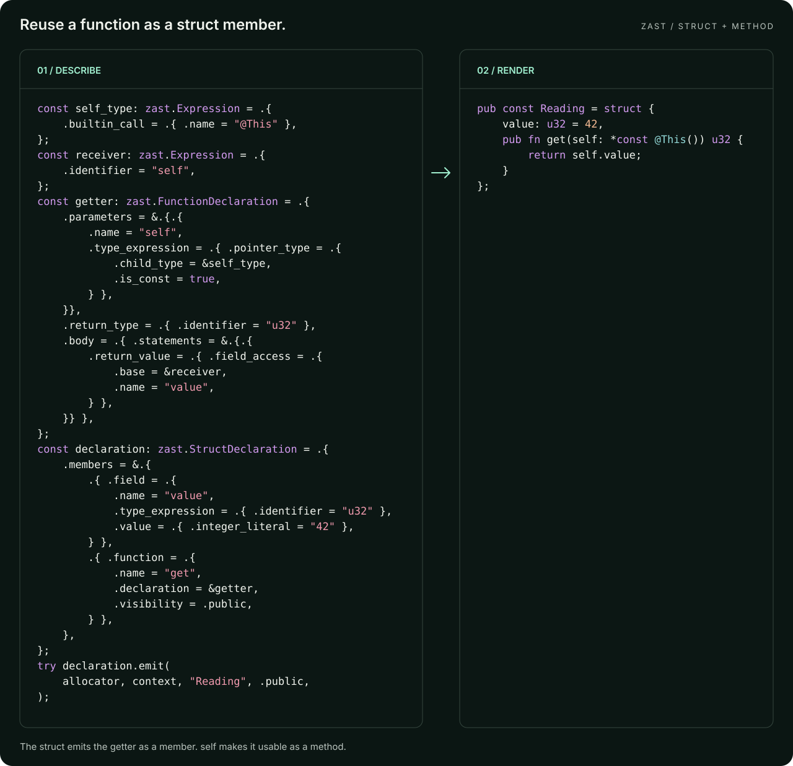](docs/examples.md#6-reuse-a-function-inside-a-struct)

[Copy code](docs/examples.md#6-reuse-a-function-inside-a-struct) ·
[Runnable example](examples/struct.zig) · [Related tests](tests/test_struct_declaration.zig)

The same `FunctionDeclaration` describes a top-level function or a struct
member. The explicit `self` parameter makes this function usable as a method.
The struct emits the member; do not also emit `getter` at the file root.

## 7. Embed an anonymous type

[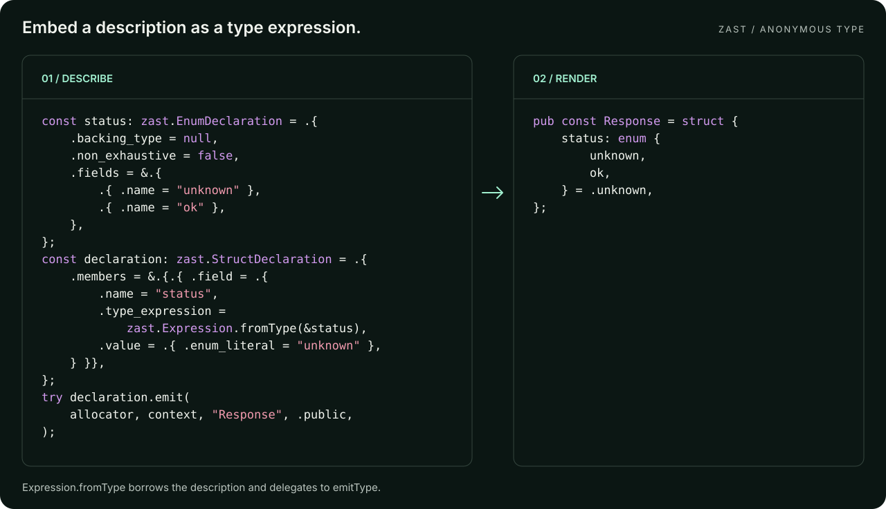](docs/examples.md#7-embed-an-anonymous-type)

[Copy code](docs/examples.md#7-embed-an-anonymous-type) ·
[Runnable example](examples/type_composition.zig) · [Related tests](tests/test_type_composition.zig)

`Expression.fromType` borrows the descriptor and delegates to its `emitType`
method. The enclosing field supplies the name and default value. To refer to
an already declared type, use `.identifier = "Status"` instead; embedding the
same description again creates another type expression.

## 8. A builtin call

[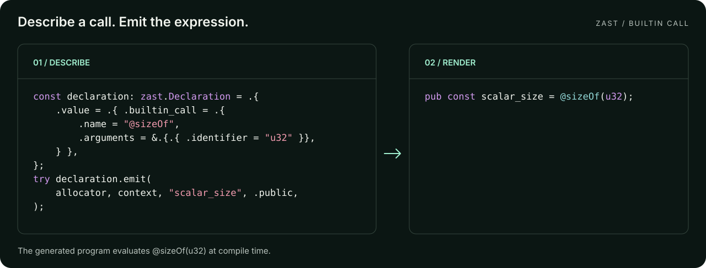](docs/examples.md#8-a-builtin-call)

[Copy code](docs/examples.md#8-a-builtin-call) ·
[Runnable example](examples/calls.zig) · [Related tests](tests/test_call_expression.zig)

This emits a call for the generated program. Zig evaluates it when that program
is compiled; `scalar_size` is 4. Ordinary calls use `.call` with a callee
expression; [calls.zig](examples/calls.zig) also composes imports and member access.

## 9. A value initializer

[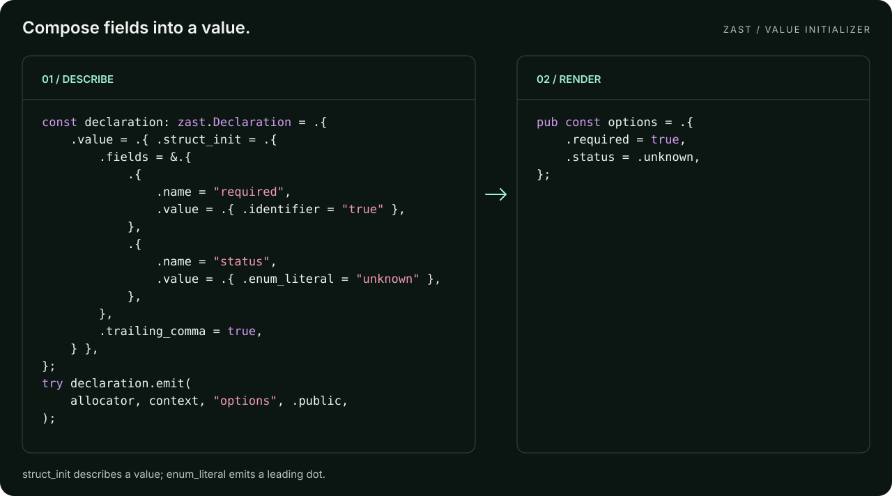](docs/examples.md#9-a-value-initializer)

[Copy code](docs/examples.md#9-a-value-initializer) ·
[Runnable example](examples/initializers.zig) · [Related tests](tests/test_initializer_expression.zig)

`struct_init` describes a value. Set its `type_expression` to generate a typed
initializer such as `Options{ ... }`. See [initializers.zig](examples/initializers.zig)
for empty, nested, and positional initializers.

## 10. Comments and documentation

[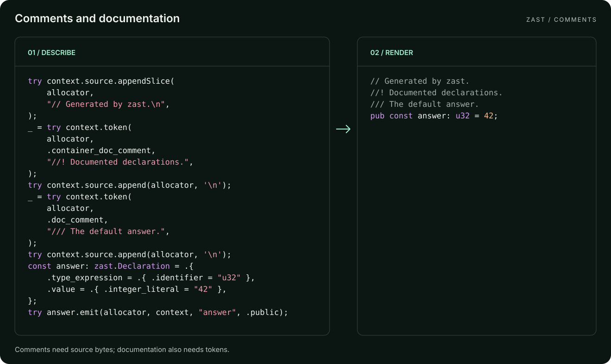](docs/examples.md#10-comments-and-documentation)

[Copy code](docs/examples.md#10-comments-and-documentation) ·
[Runnable example](examples/comments.zig) · [AST lifecycle tests](tests/test_ast_context.zig)

Generate a file header, file documentation, and documentation for the following
declaration:

| Generated syntax | Purpose | Emit with |
| --- | --- | --- |
| `// Generated by zast.` | Ordinary comment or file header | `context.source.appendSlice` |
| `//! Documented declarations.` | File or container documentation | `context.token` with `.container_doc_comment` |
| `/// The default answer.` | Documentation for the following declaration | `context.token` with `.doc_comment` |

End every comment with a newline. `context.token` adds a separating space, so
append `'\n'` after each documentation token. Comments do not need AST nodes.

Run the complete example with `zig build run-comments`. The illustration's
[copyable code](docs/examples.md#10-comments-and-documentation) uses the shared
runner; [comments.zig](examples/comments.zig) includes its own setup and cleanup.

## 11. A function pointer type

[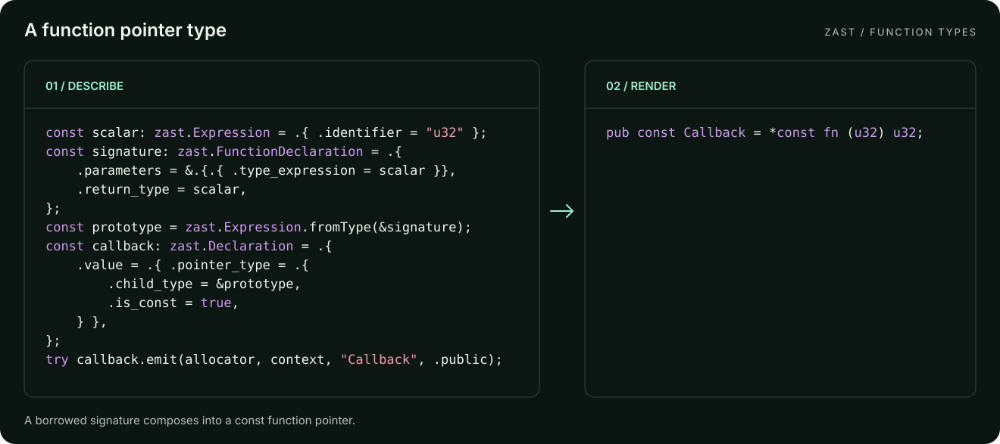](docs/examples.md#11-a-function-pointer-type)

[Copy code](docs/examples.md#11-a-function-pointer-type) ·
[Runnable example](examples/function_types.zig) · [Related tests](tests/test_function_declaration.zig)

Function type parameters can omit names. `Expression.fromType` emits the
signature without a body; wrapping it in a const pointer creates a callable
callback type.

## 12. Nested blocks

[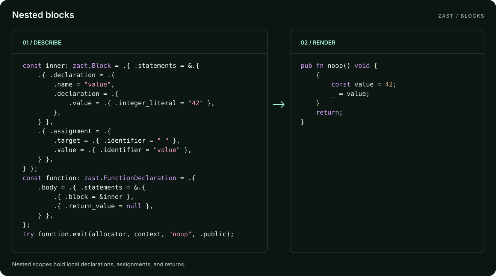](docs/examples.md#12-nested-blocks)

[Copy code](docs/examples.md#12-nested-blocks) ·
[Runnable example](examples/blocks.zig) · [Related tests](tests/test_function_declaration.zig)

`Block.Statement.block` nests a borrowed block. Assignment to `_` discards a
value, and a null `return_value` emits a bare `return;`. The default function
return type is `void`.

## 13. Comptime parameters and error propagation

[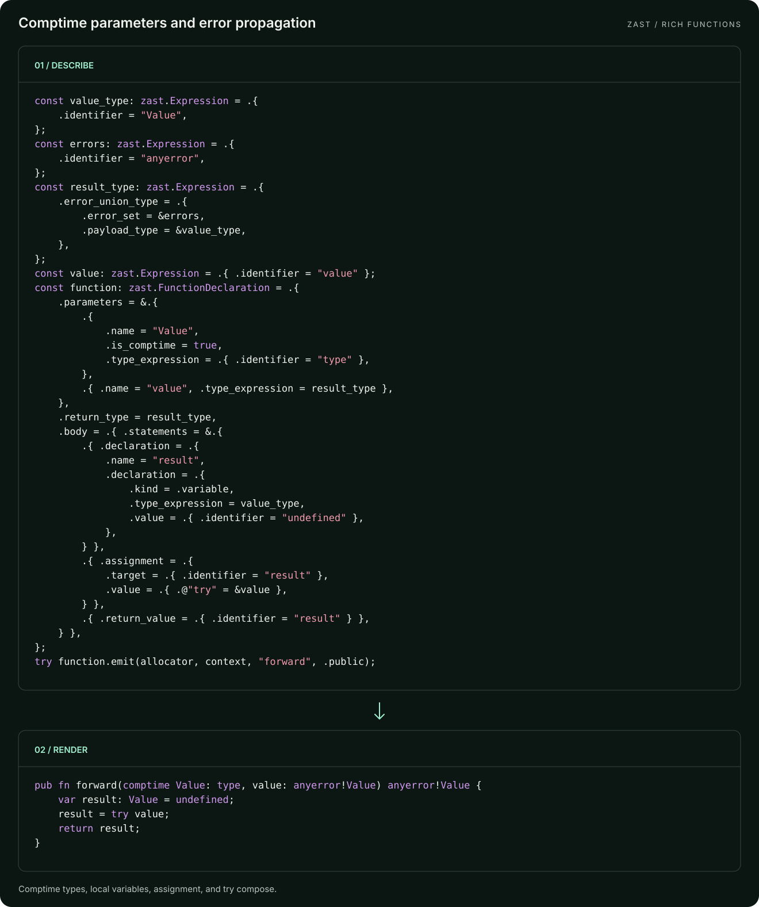](docs/examples.md#13-comptime-parameters-and-error-propagation)

[Copy code](docs/examples.md#13-comptime-parameters-and-error-propagation) ·
[Runnable example](examples/rich_functions.zig) · [Related tests](tests/test_function_declaration.zig)

A `comptime` type parameter determines the error-union parameter and return
types. The body combines a local `var`, assignment, and `try`; errors return
before the uninitialized local is read. The runnable example emits this
standalone function.

## 14. JSON schema playground

[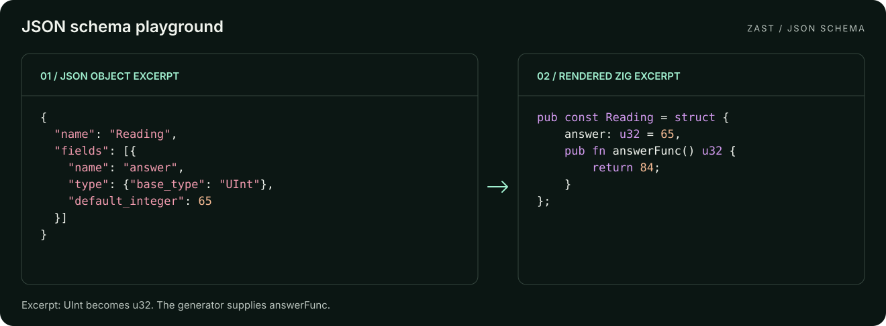](docs/examples.md#14-json-schema-playground)

[Copy code](docs/examples.md#14-json-schema-playground) ·
[Runnable example](examples/json_schema/main.zig) · [Struct tests](tests/test_struct_declaration.zig) · [Enum tests](tests/test_enum_declaration.zig)

Map a JSON schema field to a native Zig field and preserve its default. The
playground also adds a fixed example method.
The illustration shows excerpts; the linked guide provides full inputs and output.

## 15. FlatBuffers JSON

[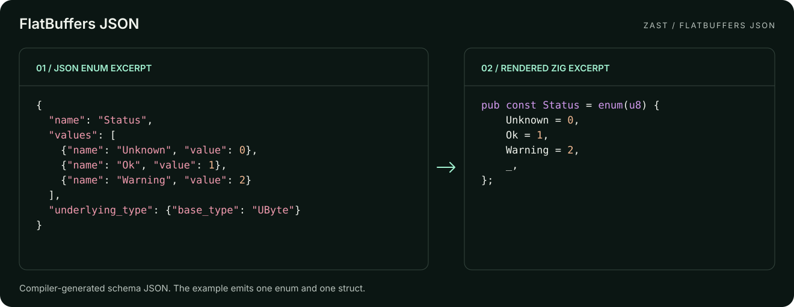](docs/examples.md#15-flatbuffers-json)

[Copy code](docs/examples.md#15-flatbuffers-json) ·
[Runnable example](examples/flatbuf_json/main.zig) · [Related tests](tests/test_flatbuf_json.zig)

Read a small compiler-generated FlatBuffers schema JSON describing an enum
and a table, then emit ordinary Zig declarations. This demonstrates one use
of `zast`; the linked guide contains the complete input and output.

## Complete runner

[Runnable example](examples/declarations.zig) · [AST lifecycle tests](tests/test_ast_context.zig)

The [complete runner](docs/examples.md#complete-runner) includes the imports,
allocator and AST setup, rendering, cleanup, and command to run an example.
Replace its `generate` body with one of the copyable Zig snippets.

## Ownership and formatting

The Zig snippets use stack descriptions and need no descriptor cleanup. Components
also provide `init` for descriptions allocated in a parent arena; their fields,
names, and child expressions remain borrowed. Keep all borrowed data alive
until emission completes, and release the arena afterwards.

AST buffers use the allocator passed to `emit`. Token spelling is copied into
the context. The renderer formats the finished AST; it does not type-check the
generated program. Compile generated output to verify name resolution and
semantics. Identifier and literal spellings must already be valid Zig syntax;
use `std.zig.fmtId` when converting external names.

## Runnable examples and schema input

Run these commands from this directory:

| Command | Example | Related tests |
| --- | --- | --- |
| `zig build run-declarations` | [Constants, variables, strings, optionals, and address-of](examples/declarations.zig) | [Declarations](tests/test_declaration.zig) |
| `zig build run-comments` | [Generated headers, file documentation, and declaration documentation](examples/comments.zig) | [AST lifecycle](tests/test_ast_context.zig) |
| `zig build run-struct` | [Fields, defaults, a receiver method, and struct layouts](examples/struct.zig) | [Structs](tests/test_struct_declaration.zig) |
| `zig build run-enum` | [Enum with arena-backed initialization](examples/enum.zig) | [Enums](tests/test_enum_declaration.zig) |
| `zig build run-union` | [Union tag variants](examples/union.zig) | [Unions](tests/test_union_declaration.zig) |
| `zig build run-function` | [Function](examples/function.zig) | [Functions](tests/test_function_declaration.zig) |
| `zig build run-function-types` | [Anonymous function signatures and callback pointers](examples/function_types.zig) | [Prototypes](tests/test_function_declaration.zig), [type composition](tests/test_type_composition.zig) |
| `zig build run-blocks` | [Nested blocks, expression statements, and bare returns](examples/blocks.zig) | [Functions and blocks](tests/test_function_declaration.zig) |
| `zig build run-compound-types` | [Arrays, pointers, slices, optionals, and errors](examples/compound_types.zig) | [Type expressions](tests/test_expression.zig) |
| `zig build run-calls` | [Ordinary and builtin calls](examples/calls.zig) | [Calls](tests/test_call_expression.zig) |
| `zig build run-initializers` | [Named and positional initializers](examples/initializers.zig) | [Initializers](tests/test_initializer_expression.zig) |
| `zig build run-type-composition` | [Nested types and type-returning functions](examples/type_composition.zig) | [Type composition](tests/test_type_composition.zig) |
| `zig build run-rich-functions` | [Comptime parameters, assignments, and error propagation](examples/rich_functions.zig) | [Function bodies](tests/test_function_declaration.zig), [calls](tests/test_call_expression.zig) |
| `zig build run-json-schema` | [Original JSON playground](examples/json_schema/main.zig) | [Schema enums](tests/test_enum_declaration.zig) |
| `zig build run-flatbuf-json` | [Small FlatBuffers schema JSON example](examples/flatbuf_json/README.md) | [JSON example](tests/test_flatbuf_json.zig) |